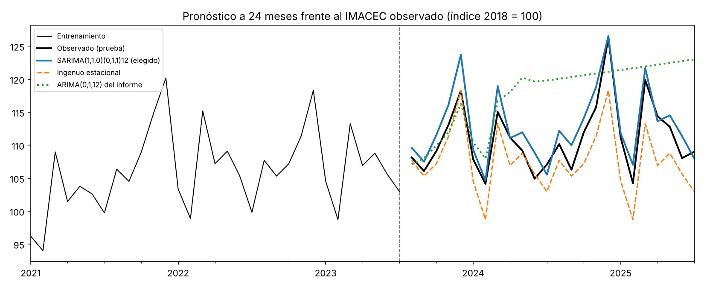

# Pronóstico del IMACEC de Chile con modelos ARIMA

> **English summary.** Time-series forecasting of Chile's monthly economic activity index (IMACEC, Jan 2018 – Jul 2025, 91 observations) following the Box-Jenkins methodology. A Python notebook revisits an earlier Gretl report with an explicit train/test cutoff, like-for-like AIC comparisons, a seasonal naive baseline and errors measured in index points. The selected model, SARIMA(1,1,0)(0,1,1)12 on the log series, has a 24-month test MAE of 2.14 index points (MAPE 1.93 %) against 3.50 for the seasonal naive baseline. The model chosen in the original report, ARIMA(0,1,12), does not hold up: its test MAE is 7.47.

## Qué resuelve

El IMACEC es el indicador mensual de actividad económica que publica el Banco Central de Chile. El proyecto busca un modelo univariado que lo pronostique a 24 meses y comprueba si supera a la alternativa más simple: repetir el valor del mismo mes del año anterior.

## Resultados

Pronóstico de 24 meses (agosto de 2023 a julio de 2025) con modelos estimados solo con datos hasta julio de 2023. Errores en puntos del índice (base 2018 = 100):

| Modelo | MAE | RMSE | MAPE |
|---|---|---|---|
| **SARIMA(1,1,0)(0,1,1)12 (elegido)** | **2,14** | 2,51 | 1,93 % |
| Ingenuo estacional (modelo base) | 3,50 | 4,24 | 3,13 % |
| ARIMA(0,1,12) (modelo del informe original) | 7,47 | 9,10 | 6,84 % |



- El modelo se eligió con validación de origen móvil dentro del entrenamiento (5 orígenes, horizonte de 12 meses), sin usar los meses de prueba.
- La ventaja sobre el modelo base viene del segundo año: en los primeros 12 meses el ingenuo estacional es algo mejor (MAE 2,07 frente a 2,33) y en los meses 13 a 24 el modelo gana con claridad (1,95 frente a 4,93).

## Sobre el informe original

`report/IMACEC_REPORT.docx` es un trabajo anterior hecho en Gretl (la sesión está en `models/DEF.gretl`). El notebook de Python lo revisa y encuentra que **su modelo final no se sostiene**:

- El informe compara AIC de modelos en niveles y en logaritmos, y sobre muestras de distinto largo, lo que no es válido.
- Concluye que basta una primera diferencia. En el tramo de entrenamiento usado aquí, la prueba ADF no rechaza la raíz unitaria tras una sola diferencia (p = 0,49); hace falta además la diferencia estacional.
- El coeficiente MA(12) del modelo elegido está en el límite de invertibilidad (0,999999), señal de que falta esa diferencia estacional.
- Las métricas que reporta (MAPE 0,71; MAE 0,033; RMSE 0,043) son consistentes con errores de ajuste dentro de la muestra medidos sobre el logaritmo, no con errores de pronóstico en puntos del índice.

El informe se conserva en el repositorio como registro del trabajo original; los resultados vigentes son los del notebook.

## Cómo reproducirlo

```bash
pip install -r requirements.txt
jupyter nbconvert --to notebook --execute --inplace notebooks/imacec_arima_python.ipynb
```

Probado con Python 3.13. Los datos ya están en el repositorio.

## Datos

`data/IMACEC.xlsx`: planilla del Banco Central de Chile con el IMACEC (volumen a precios del año anterior encadenado, índice promedio 2018 = 100). Se usa la serie original, sin desestacionalizar, de enero de 2018 a julio de 2025. Las cifras más recientes son preliminares y el Banco Central las revisa.

## Estructura

```
data/IMACEC.xlsx                        serie del Banco Central
notebooks/imacec_arima_python.ipynb     análisis en Python (statsmodels)
figures/                                gráficos del informe original y del notebook
models/DEF.gretl                        sesión de Gretl del informe original
report/IMACEC_REPORT.docx               informe original
requirements.txt
```

## Limitaciones

- Muestra corta (67 meses de entrenamiento) que incluye la pandemia de 2020; no se modeló con variables de intervención.
- Una sola ventana de prueba de 24 meses y solo 5 orígenes de validación.
- Modelo univariado: no usa otras variables económicas.

## Stack

Python, pandas, statsmodels y matplotlib. El informe original usa Gretl.
